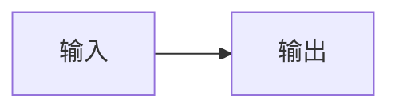
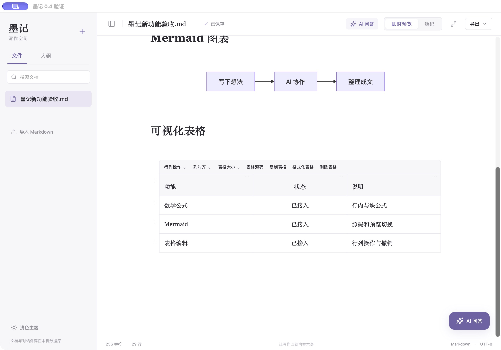

# 墨记 0.4：数学、Mermaid 和可视化表格

本轮已把三项功能接入应用，保留 Rust/Tauri、SQLite、本机 Codex 和第三方 OpenAI 兼容 API 的原有架构。没有迁移数据库格式，也没有重启正在使用的旧墨记窗口。

## 数学公式

输入 `$E=mc^2$` 即可显示行内公式。块公式使用两行独立的双美元包围：

```tex
$$
\int_0^1 x^2\,dx = \frac{1}{3}
$$
```

点击公式返回 TeX 源码；行内公式编辑时显示预览浮层，块公式在源码下显示预览。工具栏「插入公式」会插入一个块公式。代码中的美元和普通价格不会按同样规则强制转为公式。

使用本地 MathJax 4.1.3 和 MathJax TeX 字体，不需要 CDN 或外部字体下载。支持本版本加载的 base/ams/newcommand/textmacros/color/configmacros，块公式自动编号，可用 `\label`、`\ref`、`\eqref`（含前向引用）和 `\tag`/`\notag`。编辑错误显示错误信息，并尽可能保留已有有效预览；修复后清除提示。

排版按整组公式处理，交由 MathJax 的引用重编译阶段完成 label/ref；同一公式组缓存共用结果。原始 TeX 和位置保存在 Markdown 中，不从 SVG 恢复原文。输入中重绘约100ms防抖，异步结果带渲染令牌，已失效或移出文档的结果不会写回。

## Mermaid

在源码中输入 `mermaid` 围栏，或点击工具栏「插入 Mermaid」。例如：

````markdown

````

失焦时显示图形，点击图形返回同块源码；修改时约200ms后更新。错误消息附带引擎可用的行号，修复后自动恢复。支持明暗主题重绘。

使用锁定的 Mermaid 11.17.2，采用其公开 `initialize` / `render` 接口、strict 安全模式、SVG 文字标签。初始化与渲染按队列执行；块级令牌防止旧异步结果覆盖新内容。KaTeX 间接依赖覆盖为0.18.2，本次 npm audit 为0项已报告漏洞。这是当次依赖扫描结果，不是所有输入的安全证明。

已验证中文 flowchart、sequenceDiagram、classDiagram 和 gantt。其他随主包支持的图种可尝试，但不把它们全都写成已逐项验收；没有额外加载 ZenUML 插件。

## 可视化表格

点击单元格进入 Markdown 格内编辑，离开后显示排版。转义竖线、行内代码和公式保留为单元格内容，数据修改直接映射到原文范围。

- 「行列操作」：上下插入行、左右插入列、删除行/列、上下移动行、左右移动列。
- 行左侧和表头上的把手：拖动重排行、列；整列移动时对齐信息一起移动。
- 「列对齐」：默认、左、中、右；Shift 点击另一格可形成矩形选择，再对所选列操作或复制/清空。
- 「表格大小」：调整到目标行列数，上限99行40列（含表头）；缩小删除的内容可撤销。
- 「表格源码」：临时展开原始表格，离开焦点后回到可视化表格；顶部「源码」切换仍显示整篇原文。
- 「复制表格」：复制 Markdown；「格式化表格」统一表格间隔写法；「删除表格」删除当前表格。
- Tab / Shift+Tab：前后单元格；末尾Tab可增行。Enter：同列下一行；Cmd/Ctrl+Enter：插入下一行；Shift+Enter：格内换行标记。
- 从表格软件复制带Tab/换行的矩阵可粘贴到当前格开始的矩形区域，必要时增行/列；整组修改可撤销。

格内文字、结构命令和 AI 写回使用同一文档状态、原文范围映射和撤销栈。中文组合输入期间不提交中间文本，结束时一次提交。表格选文可发送 AI、预览、确认替换并撤销。

## 导出与打印

Markdown 导出保持原文。网页导出等待数学和 Mermaid 完成，包含 SVG 和数学样式，不依赖打开墨记才能查看。打印入口先从原文生成独立排版面，避免把格内编辑器和工具条打印出来；实际打印/PDF成品本次没有逐份人工验收。

## 验证

- 23项 Node 核心测试：原文/CRLF/混合换行、500次确定性随机编辑、选区/撤销、公式识别/引用/错误、表格模型/结构/前缀和历史。
- 46项 Chrome/WebKit 流程测试：原有编辑/持久化/原生IPC模拟/AI流程，加数学渲染和错误恢复、四种图表、主题、快速修改、表格编辑/导航/增删移动/对齐/尺寸/粘贴/拖动撤销、组合输入、AI表格写回、源码入口和HTML SVG导出。
- 6项 Rust 后端测试：数据库事务和历史、非法覆盖保护、接口配置、SSE与模拟兼容API。
- 独立 macOS 验证包 `com.fuhanshen.moji.verification04` 成功启动，实际 WKWebView 中观察到行内/块公式图像、中文流程图、表格工具和格内输入区。它使用单独数据库和自建示例，未改用户原应用数据库。截图为 `墨记0.4原生验证.jpg`。
- 本次没有再次发送真实第三方服务请求；本机Codex与真实写回的先前验证记录仍保留。浏览器使用模拟服务验证本次范围适配。

## 实现位置

`mathSyntax.js` 扩展 Lezer 语法；`mathEngine.js` 本地 SVG 排版；`specialRenderers.js` 管理缓存/队列与SVG净化；`specialWidgets.js` 处理源码焦点和渲染令牌；`tableModel.js` 处理源范围和纯结构操作；`tableWidget.js` 处理格内输入/工具/拖动/历史；`richRenderer.js` 为导出和表格内容排版；`Editor.jsx` 与 `App.jsx` 集成工具栏、主题、原文和导出。

公开来源：[MathJax直接模块与renderPromise](https://docs.mathjax.org/en/latest/server/direct.html)、[Mermaid公开渲染API](https://mermaid.js.org/config/usage.html#api-usage)、[Lezer Markdown扩展](https://github.com/lezer-parser/markdown)、[CodeMirror装饰与widget](https://codemirror.net/examples/decoration/)。实现也核对了锁定版本的类型声明和源代码。Typora调查用于说明机制，没有拷贝其专有代码或素材。

当前仍不包含合并单元格、表格计算、持久化像素列宽、所有TeX扩展或全部Mermaid插件。真实系统输入法候选、听写、辅助功能、超长文档及旧系统需进一步专项验收，不宣称与Typora所有边界完全等价。

## 交付文件

- `release/macos/墨记.app`：0.4.0，Apple Silicon arm64，标注最低macOS12（旧系统未逐项验证），本地ad-hoc签名，未进行Developer ID签名/公证。
- `release/macos/墨记-0.4.0-Apple-Silicon.zip`：6,433,867字节，SHA-256 `c6ffcc87326f0441438c6ffd2cb80c265c23c41215cc0d8c5e287cf8b9c337a4`。
- `codesign --verify --deep --strict`通过。应用id仍为`com.fuhanshen.moji`，不需要迁移数据库。旧0.3包备份在`release/macos/archive/墨记-0.3.0.app`。
- 若旧墨记仍在运行，先正常退出，再打开新的应用包；本次没有强行终止旧窗口。名为“墨记验证”的窗口是独立测试包，不是正式数据目录。


