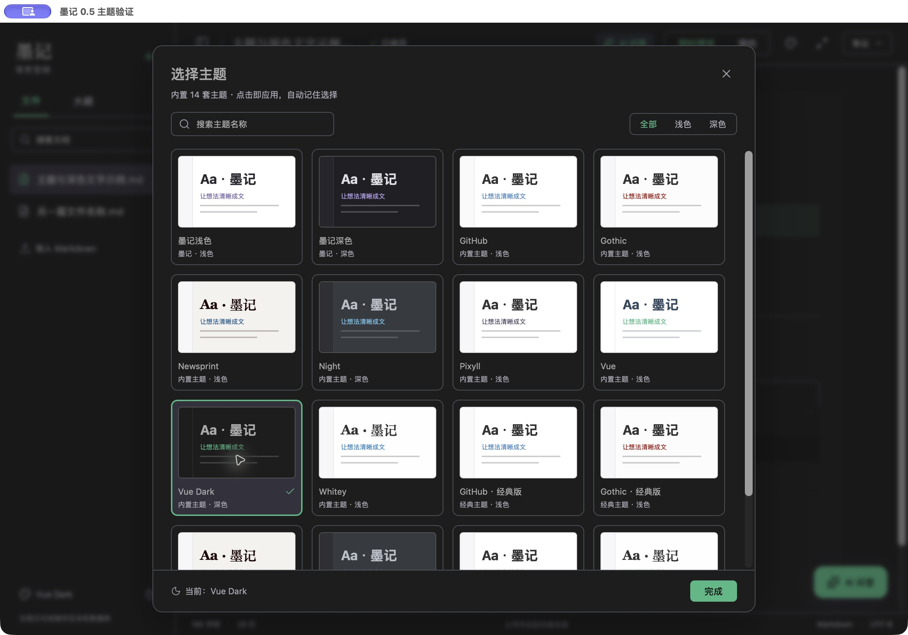
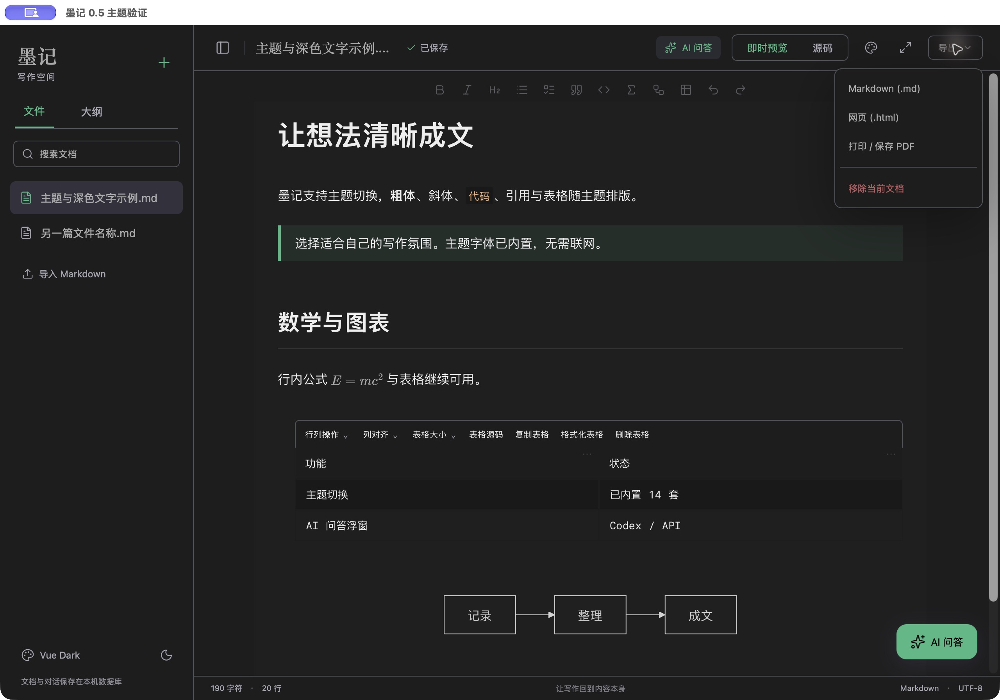

# 墨记 0.5：主题与深色文字

顶部调色盘或左下角主题名称打开「选择主题」。支持搜索、浅色/深色筛选、点击应用、自动保存选择、Esc关闭与返回入口焦点。侧栏隐藏时顶部入口仍可使用。

用户压缩包提供 14 个可选主题：GitHub、Gothic、Newsprint、Night、Pixyll、Vue、Vue Dark、Whitey，以及 GitHub、Gothic、Newsprint、Night、Pixyll、Whitey 的经典版。保留墨记浅色和墨记深色，共16个。首次运行保留已有明暗偏好；选定新主题后自动记住，不强制更换为某一主题。

## 本轮修复

「墨记」品牌、顶部文档名称、侧栏已选/未选文件名称、「导出」按钮明确使用主题文字颜色。强调色按钮自动选择黑/白前景，防止绿色等背景搭配白字造成低对比度。深色主题采用更深的选中项底色。

Safari 在鼠标点击主题卡后可能不把焦点留在卡片上，因此关闭面板的Esc监听在面板打开期间注册到文档，关闭后恢复到实际入口。小窗口中的主题面板不产生横向滚动。

## 主题导入与导出

压缩包保留原样，安全提取103个素材文件；忽略系统隐藏文件，原README按数据保留，没有执行其中指令。主题源文件和原字体声明在`themes/presets/`，应用随包包含`THEME_NOTICES.txt`。源包SHA-256记录在`themes/source.json`。14套主题本地资源缺失数为0。

构建时解析CSS及选择器，将正文规则限定在编辑器作用域，将HTML语义选择器适配到CodeMirror行/文字标记。过滤Typora专用界面规则与远程字体声明，内联本地字体、命名空间隔离字体族，每套主题独立按需载入。CSS不会直接覆盖应用工具栏和文件列表。主题为兼容适配，不承诺与Typora的DOM和像素效果完全一致。

切换主题不重建文档状态、不改变Markdown原文，光标和撤销继续共用。字体加载完成后请求编辑器重新测量。网页导出包含所选正文主题与字体；打印排版面使用所选主题，实际系统打印/PDF成品未逐份人工验收。Markdown导出保持原文。

官方实现依据：[Vite glob import](https://vite.dev/guide/features.html#glob-import)、[PostCSS selector parser](https://github.com/postcss/postcss-selector-parser#usage)。

## 自动验证

- 27项Node核心测试：原有23项与主题清单、偏好迁移、按钮前景色、编译CSS作用域/本地资源检查。
- 58项Chrome/WebKit流程测试：原有46项与两浏览器各6项主题测试，覆盖14套逐套切换、16个选项、正文保真、字体/颜色、重开记忆、搜索/筛选、快速切换、光标/撤销、离线字体、HTML主题导出、小窗口/Esc焦点恢复。
- 深色文字对比测试：墨记深色、Night、Vue Dark、Night经典版中的品牌、顶部文件名、已选/未选文件名、导出按钮、完成按钮，实际计算颜色对比均至少4.5:1。
- 6项Rust数据库/接口协议测试全部通过；本轮未更改数据库结构。
- 当次`npm audit`为0项已报告漏洞。

## 原生窗口验证

独立应用「墨记主题验证」（`com.fuhanshen.moji.verification05`）使用隔离数据库与自建示例，原生WKWebView中观察到16个主题选项，选择Vue Dark后正文、公式、表格、Mermaid均可见。「墨记」、顶部文件名、侧栏两个文件名和导出按钮/菜单清晰可读，关闭主题面板后焦点回到入口。没有改写正式应用数据库或强制退出旧墨记。

## 交付与使用

正式包为`release/macos/墨记.app`，压缩包为`release/macos/墨记-0.5.0-Apple-Silicon.zip`。应用标识仍为`com.fuhanshen.moji`，正式数据库路径保持不变。打包不强行终止用户正在使用的旧窗口；如旧窗口仍在运行，先正常退出，再打开新包。

Apple Silicon arm64，本地ad-hoc签名，未进行Developer ID签名/公证；macOS最低配置12.0，旧系统与Intel未逐项验证。

正式包校验：`codesign --verify --deep --strict`通过，arm64，正式标识已核对，未混入验证包标识；压缩包完整性和中文文件名检查通过。ZIP大小 7914260 字节，SHA-256 `65f912b0b77149612c93c28346e02df5b6282235ab0eafefe54b75c0e469c8ae`。旧0.4正式应用备份在`release/macos/archive/墨记-0.4.0.app`。
