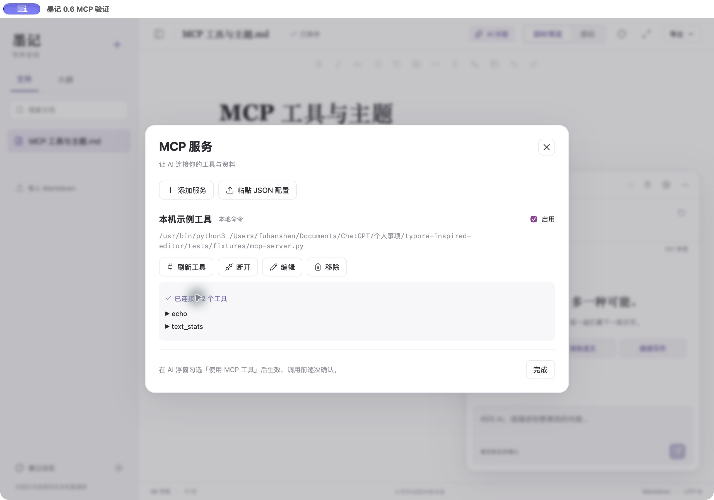
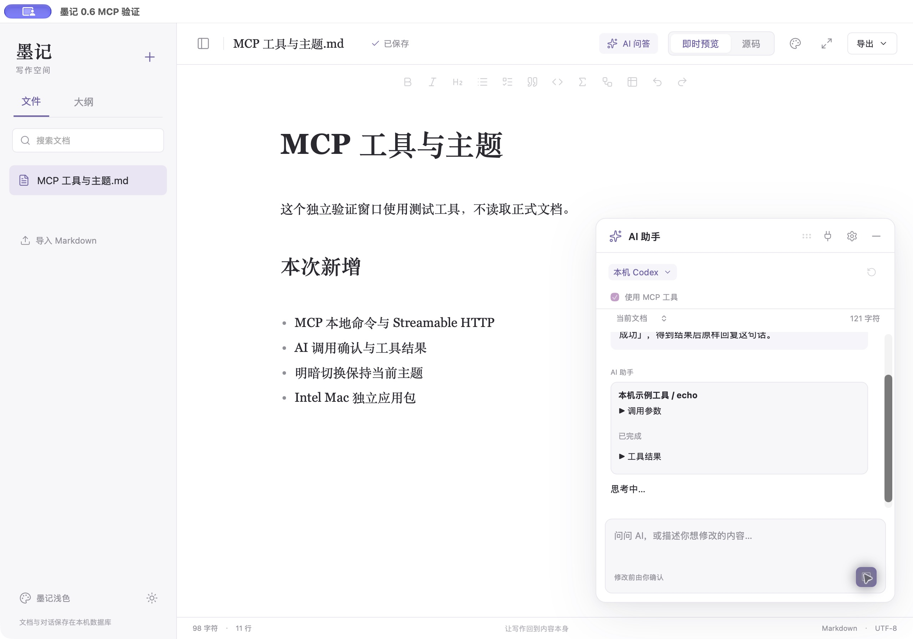

# 墨记 0.6：MCP、Intel Mac 与独立明暗模式

## MCP 怎么用

1. 打开「AI 问答」，点击右上角插头「MCP 服务」。也可从「AI 设置」进入。
2. 添加本地命令（stdio）或 Streamable HTTP 地址；参数每行一个。支持添加、编辑、移除和启停。
3. 如有凭据，使用「环境变量与请求头」JSON，例如 `{"env":{"TOKEN":"…"},"headers":{}}`；HTTP 可用 `{"headers":{"Authorization":"Bearer …"}}`。凭据保存在 macOS 钥匙串，不保存到SQLite或回显。留空保留已有凭据，勾选清除可移除。
4. 点击「连接并查看工具」，展开工具可阅读说明与参数结构。此步骤会启动你指定的本地命令或连接远程服务，不调用业务工具。
5. 也可「粘贴 JSON 配置」，接受常见 `mcpServers` / `mcp_servers` 对象、command/args/env、url/headers。同名更新，导入后不会自动连接；部分失败时已成功保存的条目保留。
6. 返回浮窗，勾选「使用 MCP 工具」后提问。AI 请求工具时展示服务、工具名和实际参数，由你允许或拒绝；执行后结果会交给模型继续回答，调用记录与本篇对话一起保存。

本地服务需在目标机器安装其所需运行环境，如 Node、Python、uv 或服务自己的可执行程序；这些第三方服务不被自动打包进墨记。命令不会经过shell展开。远程凭据变化、地址/命令变化后应核对对应服务的权限。

本机Codex复用原登录，墨记把工具清单交给它做JSON规划，通过同一确认与调用管线执行MCP。CLI继承的既有MCP服务按原有代码的配置筛选关闭，墨记不会自动导入个人Codex MCP配置。普通Codex仍为只读子进程；MCP工具本身可能读写外部数据，执行范围由服务决定。第三方API模式需支持Chat Completions的tools/function calling；MCP模式按轮返回，普通非MCP问答仍保留原流式接口。

限制：最多32个服务、提供给模型64个工具、12轮。连接/工具列表20秒超时、确认90秒超时、工具45秒超时、整次MCP问答15分钟上限。停止会取消本次等待；已发往外部服务的操作不保证回滚。配置变更会断开旧连接，并阻止旧确认使用新地址执行。未实现OAuth、旧HTTP+SSE、资源/提示词浏览、远端采样/交互输入请求。

实现使用官方Rust SDK rmcp 3.8.0，客户端以2025-11-25协议版本握手，由SDK处理传输、JSON-RPC、分页和响应。HTTP拒绝重定向，凭据不随重定向发送；错误信息不直接输出请求头或环境变量。

## 明暗模式不再切换主题

太阳/月亮按钮现在只改变明暗模式，保留主题ID、名称、字体和排版。比如Newsprint切为深色后仍是Newsprint，主题面板显示「当前：Newsprint（深色显示）」。明暗选择与主题各自保存，重新打开仍保持；切回原明暗模式恢复该主题原配色。选择另一套主题时采用该主题自然配色。

相反明暗模式适配正文、标题、引用、代码和表格颜色，不重建编辑器文档状态；原文、光标、撤销仍共用。HTML导出包含当前明暗配色，打印面沿用同样设置（实际PDF成品未逐份验收）。

## 验证

- 29项Node核心测试：原有主题/Markdown核心，加MCP JSON配置转换/凭据分离/错误格式、明暗独立状态。
- 70项Chrome/WebKit流程测试全部通过：包含MCP添加/编辑/启停/移除、连接并查看工具、导入错误、允许/拒绝调用、停止失效，以及Newsprint明暗独立保存/重开/导出和14套主题反向明暗逐套身份/原文/正文对比度检查。
- 14项Rust测试全部通过：原有6项，加服务输入校验、错误进程清理、Codex规划解析、真实stdio握手/分页/中文工具调用、真实本地HTTP握手/分页/调用、拒绝不执行/允许执行、配置变化阻止旧调用、模拟兼容API完成工具闭环。
- 当次npm依赖扫描为0项已报告漏洞。新增传输和网络代码也已通过Rust编译/测试，不把扫描结果视为所有输入的安全证明。
- ARM独立验证包（`com.fuhanshen.moji.verification06`）在原生WKWebView连接本地测试服务并发现echo/text_stats。真实本机Codex规划echo调用，出现确认，执行后返回「墨记 MCP 验证成功」，工具结果与最终回答均在独立验证数据库确认保存。未向真实第三方API发送请求。
- Intel独立验证包（`com.fuhanshen.moji.verification06intel`）确认为x86_64，在Apple Silicon本机通过Rosetta成功启动，观察到正文、公式、表格和主题界面。选择Newsprint后切到深色，再打开主题面板，Newsprint仍被选中，显示「深色显示」。这不等同于物理Intel Mac和旧系统逐项验收。

验证数据均在隔离标识的数据库中，没有重写正式文档数据库或强行结束旧墨记。

## 官方依据

- [MCP传输规范](https://modelcontextprotocol.io/specification/2025-11-25/basic/transports)
- [MCP工具发现与调用](https://modelcontextprotocol.io/specification/2025-11-25/server/tools)
- [官方Rust SDK](https://github.com/modelcontextprotocol/rust-sdk)、[rmcp 3.8.0传输接口](https://docs.rs/rmcp/3.8.0/rmcp/transport/index.html)
- [OpenAI Function Calling](https://developers.openai.com/api/docs/guides/function-calling)
- [Tauri 2 CLI构建目标](https://v2.tauri.app/reference/cli/#build)

## 交付

两个包均为0.6.0，正式应用标识保持`com.fuhanshen.moji`，无需迁移原数据库。Apple Silicon为arm64，Intel为x86_64；均本地ad-hoc签名、未Apple公证，最低配置macOS12，旧系统未逐项实测。正常退出正在运行的旧墨记，再打开对应新包。

- Apple Silicon：`release/macos/墨记.app` / `墨记-0.6.0-Apple-Silicon.zip`
- Intel：`release/macos/intel/墨记.app` / `墨记-0.6.0-Intel.zip`
- 旧0.5正式应用保留在`release/macos/archive/墨记-0.5.0.app`。

正式包已核对版本、正式标识、独立架构和系统动态库依赖；源应用和ZIP解压后的应用均通过`codesign --verify --deep --strict`，ZIP完整性与中文文件名校验通过。

- 墨记-0.6.0-Apple-Silicon.zip：10336055字节，SHA-256 `e0418b010ddadfd06c4b9ed868485d6486a41f1250e9308bf9157bed63535cc9`。
- 墨记-0.6.0-Intel.zip：11092670字节，SHA-256 `1799687c4c7bf3eb33cc463b019e266ab0e2718e2087fab4e9a1a21d5c7d041c`。
