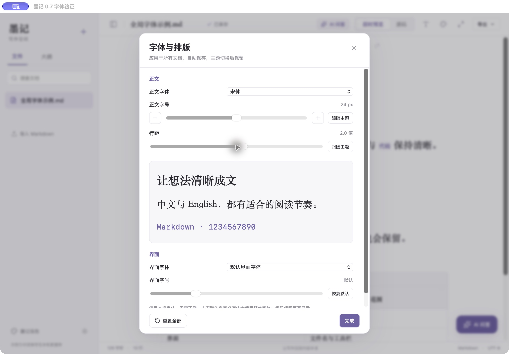

# 墨记 0.7：全局字体与排版

点击顶部「字体设置」（T图标）打开面板。修改立即应用，无需再次保存；关闭面板或切换文档后仍然保留。

## 可调项目

- 正文字体：跟随主题、系统字体、宋体、苹方、楷体、黑体、衬线、等宽、自定义字体名称。
- 正文字号：12–36px，滑块及加减按钮；标题保持所选主题原有大小比例，表格共用正文大小，代码保持等宽并随字号缩放，源码字号共用正文设置。
- 正文行距：1.3–2.6倍。
- 界面字体：独立于正文选择；文件名、侧栏、工具栏、AI浮窗和设置面板使用所选字体族。
- 界面字号：12–20px，作用于文件名、侧栏与顶部操作、AI交互区域。大字号下工具栏允许换行，小窗口不产生横向溢出。
- 每项可恢复跟随主题/默认，也可一键「重置全部」。默认不改变原主题排版。

自定义字体输入本机已安装的字体名称，例如系统字体册中的字体名。不下载或自动安装字体；字体不可用时系统使用替代字体。数学公式和Mermaid图形内部文字仍由各自排版引擎管理。

## 全局范围与保存

所有已有和新建文档共用此偏好。主题与明暗选择独立保存，切换它们不会清空字体设置。主题字号变动时仍按该主题原有标题比例计算；测量使用不可编辑的隐藏探针，不改动CodeMirror文档、选区或撤销历史。字体/字号变化后请求编辑器重新测量。

偏好保存在本机WebView存储键`moji.typography.v1`，未更改SQLite数据库结构。损坏或无效存储恢复默认，数值限制在允许范围，自定义字体以CSS字符串转义，防止破坏导出HTML样式边界。

Markdown导出保持原文。网页导出和打印面携带正文的字体、字号、标题比例和行距设置；界面字体不影响导出。所选系统字体不会自动嵌入，在另一台电脑上需有对应字体，否则系统替代。已有主题内置字体继续随原有主题导出。实际系统PDF/打印成品未逐份人工验收。

## 验证

- 32项Node核心测试通过：新增3项字体偏好校验与损坏恢复、字号范围、代码等宽/标题比例/导出隔离、自定义字体样式边界转义。
- 78项Chrome/WebKit测试通过：新增两浏览器各4项，覆盖正文/界面设置即时应用、表格字号、代码比例、标题比例、全局新建文档/源码字号、主题明暗/重开持久化与重置、光标/撤销/原文保真、HTML导出、小窗口与界面大字号。
- 14项Rust原有数据库/MCP/接口测试通过；后端业务逻辑本轮未改变。
- 独立原生应用`com.fuhanshen.moji.verification07`成功启动，在WKWebView中选择宋体、24px与2.0倍行距，观察到面板预览与正文排版变化；Esc关闭后焦点返回字体入口。使用独立示例数据库，未修改正式文档或终止正在使用的旧墨记。
- Apple Silicon与Intel均构建0.7.0独立正式包。Intel此前0.6版本已在本机Rosetta验证启动；本轮检查实际x86_64架构、版本和签名，未在物理Intel Mac或旧系统逐项验收。

## 交付

- Apple Silicon：`release/macos/墨记.app`与`墨记-0.7.0-Apple-Silicon.zip`。
- Intel：`release/macos/intel/墨记.app`与`墨记-0.7.0-Intel.zip`。
- 正式标识仍为`com.fuhanshen.moji`，数据目录保持不变，无需数据库迁移。
- 两版均本地ad-hoc签名，未Developer ID签名/Apple公证，最低配置macOS12，旧系统未逐项验证。
- 正常退出旧版后打开新版；0.6应用分别备份在`release/macos/archive/墨记-0.6.0.app`及`墨记-0.6.0-Intel.app`。

正式包已核对版本、正式标识、独立架构和系统动态库依赖；源应用和ZIP解压后的应用均通过`codesign --verify --deep --strict`，ZIP完整性与中文文件名校验通过。

- 墨记-0.7.0-Apple-Silicon.zip：10339806字节，SHA-256 `a17bf7cb33b099d5bd2fd78576d06ccb402d099036ca62146ddce20755c7ebce`。
- 墨记-0.7.0-Intel.zip：11095373字节，SHA-256 `b4b5192db63029abd4d429fcff08b80ac8ff5b63b913caf61a435fca7abf21a8`。
